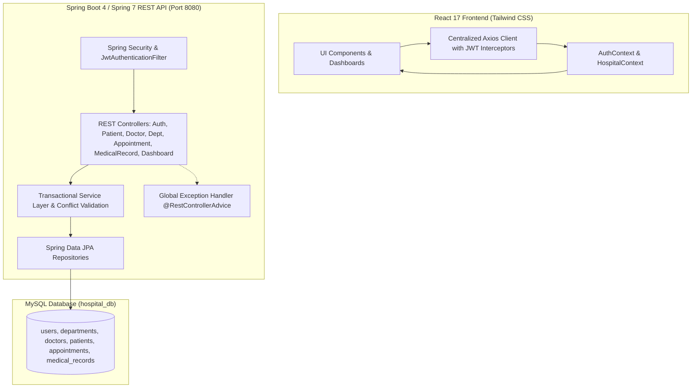

# MediCare - Multi-Speciality Hospital Management System

A production-hardened, full-stack hospital management platform built with **Spring Boot**, **MySQL**, and **React**. The system provides enterprise-grade healthcare workflows, role-based access control (RBAC), stateless JWT authentication, database-backed patient management, server-side appointment conflict prevention, and medical record security.

---

## 🏥 System Overview & Core Capabilities

- **Secure Authentication & RBAC**: Stateless JWT authentication with BCrypt password hashing, securing REST APIs for `ADMIN`, `DOCTOR`, and `RECEPTIONIST` roles.
- **Patient Management (CRUD)**: Complete clinical registration, automated medical record numbers (`P001`, `P002`, ...), demographic data, medical histories, search, status filtering, and safe cascade deletion.
- **Doctor & Department Directory**: Multi-speciality department management with bed capacity tracking, doctor profiles, availability toggles, and relational constraints preventing orphaned departments.
- **Atomic Appointment Scheduling**: Real-time booking with server-side conflict detection preventing overlapping doctor bookings on identical date/time slots, with cancellation and filtering.
- **Confidential Medical Records**: Encrypted and role-protected clinical diagnosis, treatment plans, visit notes, and prescriptions restricted to attending physicians and hospital administration.
- **Live Database-Driven Analytics**: Dashboards and clinical reports calculated dynamically from MySQL records rather than mock data.

---

## 🏛 Architecture & Tech Stack



| Layer | Technology | Key Details |
| :--- | :--- | :--- |
| **Frontend** | React 17, Tailwind CSS, Axios, React Router 6 | Component modularity, Toast alerts, JWT request interceptors |
| **Backend** | Spring Boot, Spring Security, Spring Data JPA, JJWT 0.12.6 | RESTful APIs, BCrypt, Stateless JWT, Global error handler |
| **Database** | MySQL 8.0+ / 9.x | Normalized relational schema with composite indexes |
| **Testing** | JUnit 5, Spring Boot Test, H2 in-memory, Jest, React Testing Library | Full service, integration, and UI test coverage |
| **DevOps** | Docker, Docker Compose, Multi-stage builds | Production containerization ready |

---

## 📂 Repository Structure

```
Multi-Speciality-Hospital-Management-System/
├── docker-compose.yml                     # Multi-container orchestration
├── README.md                              # Complete system documentation
├── hospital-backend/                      # Spring Boot REST API
│   ├── Dockerfile                         # Multi-stage JDK 21 build
│   ├── .env.example                       # Backend environment template
│   ├── pom.xml                            # Maven build configuration
│   └── src/
│       ├── main/
│       │   ├── java/com/hms/
│       │   │   ├── config/                # DataInitializer seed service
│       │   │   ├── controller/            # REST Controllers
│       │   │   ├── dto/                   # Request/Response DTOs
│       │   │   ├── entity/                # JPA Persistence Entities
│       │   │   ├── exception/             # Centralized exception handling
│       │   │   ├── repository/            # Spring Data JPA repositories
│       │   │   ├── security/              # JWT utilities & Security config
│       │   │   └── service/               # Core business & conflict logic
│       │   └── resources/
│       │       ├── application.properties # Parameterized configuration
│       │       └── db/schema.sql          # Reproducible MySQL schema
│       └── test/                          # JUnit 5 integration tests
└── reactapp/                              # React Single Page Application
    ├── Dockerfile                         # Multi-stage Nginx build
    ├── .env.example                       # Frontend environment template
    ├── package.json                       # Dependencies & scripts
    └── src/
        ├── components/                    # Dashboards, forms, modals
        ├── context/                       # AuthContext & HospitalContext
        ├── services/api.js                # Centralized Axios client
        └── tests/App.test.js              # React Testing Library test suite
```

---

## 🔑 Demo Credentials

On first run, the database automatically seeds secure accounts hashed with BCrypt. Quick-access buttons on the login screen allow instantaneous authentication:

| Role | Email | Password | Access Privileges |
| :--- | :--- | :--- | :--- |
| **Administrator** | `admin@hospital.com` | `admin123` | Full administrative control, all records, departments, reports |
| **Doctor** | `doctor@hospital.com` | `doctor123` | Doctor dashboard, schedule, medical records creation, patients |
| **Receptionist** | `receptionist@hospital.com` | `reception123` | Patient registration, directory, and appointment scheduling |

---

## 🛠 Prerequisites & Local Setup

### Prerequisites
- **Java SE Development Kit 21+**
- **Node.js (v18+) & npm**
- **MySQL Server 8.0+ / 9.x** (or Docker)

### 1. Database Initialization

Log into MySQL and verify/create `hospital_db`:

```sql
CREATE DATABASE IF NOT EXISTS hospital_db CHARACTER SET utf8mb4 COLLATE utf8mb4_unicode_ci;
```

Run the schema script:
```bash
# Windows PowerShell
Get-Content "./hospital-backend/src/main/resources/db/schema.sql" | & "mysql" -u root -p hospital_db

# Linux / macOS
mysql -u root -p hospital_db < hospital-backend/src/main/resources/db/schema.sql
```

### 2. Backend Configuration & Launch

1. Navigate to `hospital-backend`:
   ```bash
   cd hospital-backend
   ```
2. Configure environment variables (or copy `.env.example`):
   ```properties
   PORT=8080
   DB_URL=jdbc:mysql://localhost:3306/hospital_db?createDatabaseIfNotExist=true&useSSL=false&allowPublicKeyRetrieval=true&serverTimezone=UTC
   DB_USERNAME=root
   DB_PASSWORD=your_password
   JWT_SECRET=your_256_bit_secret_key
   ```
3. Run the Spring Boot application:
   ```bash
   # Windows
   .\mvnw.cmd spring-boot:run

   # Linux / macOS
   ./mvnw spring-boot:run
   ```
   The backend starts at `http://localhost:8080`.

### 3. Frontend Configuration & Launch

1. In a new terminal, navigate to `reactapp`:
   ```bash
   cd reactapp
   ```
2. Install dependencies:
   ```bash
   npm install --legacy-peer-deps
   ```
3. Start the React development server:
   ```bash
   npm start
   ```
   The client opens at `http://localhost:3000`.

---

## 📡 REST API Documentation

### Authentication (`/api/auth`)
- `POST /api/auth/login`: Authenticate credentials, returns JWT token + user profile.
- `POST /api/auth/register`: Register a new hospital user.
- `GET /api/auth/me`: Retrieve currently authenticated user context.

### Patient Management (`/api/patients`)
- `GET /api/patients`: List patients (supports `search` and `status` query filters).
- `GET /api/patients/{id}`: Retrieve full profile for a single patient.
- `POST /api/patients`: Register patient with auto-generated patient ID.
- `PUT /api/patients/{id}`: Update patient details.
- `DELETE /api/patients/{id}`: Safe cascade deletion of patient, appointments, and records.

### Doctors (`/api/doctors`)
- `GET /api/doctors`: List all doctors (supports `department` filter).
- `GET /api/doctors/{id}`: Get specific doctor profile and schedule.
- `POST /api/doctors`: Add a new doctor.
- `PUT /api/doctors/{id}`: Update doctor details.
- `PATCH /api/doctors/{id}/availability`: Toggle doctor availability in real time.
- `DELETE /api/doctors/{id}`: Remove doctor record.

### Departments (`/api/departments`)
- `GET /api/departments`: List hospital departments, beds, and occupancy.
- `GET /api/departments/{id}`: Retrieve department details.
- `POST /api/departments`: Create department [Admin only].
- `PUT /api/departments/{id}`: Update department capacity and specialties [Admin only].
- `DELETE /api/departments/{id}`: Delete department (protected against deletion if doctors are assigned) [Admin only].

### Appointment Scheduling (`/api/appointments`)
- `GET /api/appointments`: List appointments (filterable by `date`, `doctorId`, `patientId`, `status`).
- `GET /api/appointments/{id}`: Retrieve appointment details.
- `POST /api/appointments`: Book appointment with atomic duplicate slot validation (returns `409 Conflict` on overlap).
- `PUT /api/appointments/{id}`: Modify appointment date, time, or doctor.
- `PATCH /api/appointments/{id}/cancel`: Cancel appointment status.
- `DELETE /api/appointments/{id}`: Delete appointment.

### Medical Records (`/api/medical-records`)
- `GET /api/medical-records`: List records (filterable by `patientId`).
- `GET /api/medical-records/{id}`: Get clinical record details.
- `POST /api/medical-records`: Create medical record [Doctor or Admin only].
- `PUT /api/medical-records/{id}`: Update diagnosis, treatment, or prescription notes.
- `DELETE /api/medical-records/{id}`: Delete clinical record [Admin only].

### Analytics & Reports (`/api/dashboard`)
- `GET /api/dashboard/stats`: Returns database aggregations (patient count, doctor availability, appointment statuses, department workload).

---

## 🧪 Automated Testing

### Backend Unit & Integration Tests
Runs isolated tests using in-memory H2 database with MySQL dialect:
```bash
cd hospital-backend
.\mvnw.cmd test
```
**Test Results**: 10 tests executed, 0 failures, 0 errors.
- `AppointmentServiceTest`: verifies booking, status updates, and `ConflictException` on overlapping doctor time slots.
- `PatientServiceTest`: verifies CRUD, auto-generation of `P00x` IDs, and input validations.
- `AuthAndSecurityTest`: verifies registration, BCrypt password verification, and JWT generation.
- `HospitalBackendApplicationTests`: verifies context bootstrap.

### Frontend Component & Integration Tests
Runs React Testing Library test suites:
```bash
cd reactapp
npm test -- --watchAll=false
```
**Test Results**: 6 tests executed, 6 passed.
- Verifies initial login layout, demo credential population, patient directory, appointment scheduling form validation, and route guards.

---

## 🐳 Docker Deployment

The application includes production multi-stage Dockerfiles and a docker-compose setup:

```bash
# Build and launch all services (MySQL, Spring Boot, Nginx React)
docker-compose up --build -d

# Check running containers
docker-compose ps

# Stop all services
docker-compose down
```

Access Points:
- **Frontend**: `http://localhost:3000`
- **Backend API**: `http://localhost:8080/api`
- **MySQL Server**: `localhost:3306`

---

## 🔒 Security Hardening Implemented

1. **Password Encryption**: All passwords stored using Spring Security's `BCryptPasswordEncoder` (10 rounds). Plaintext passwords never stored.
2. **Stateless JWT**: JJWT 0.12.6 with HMAC SHA-256 signatures, validated on every request via `JwtAuthenticationFilter`.
3. **CORS Restrictions**: Explicitly configured for frontend origins (`http://localhost:3000`), blocking arbitrary domains.
4. **Environment Variables**: Sensitive credentials separated from source code into `.env.example` templates.
5. **Role-Based Authorization**: Strict endpoint guards preventing non-clinicians from creating medical records, and non-admins from altering hospital departments.
